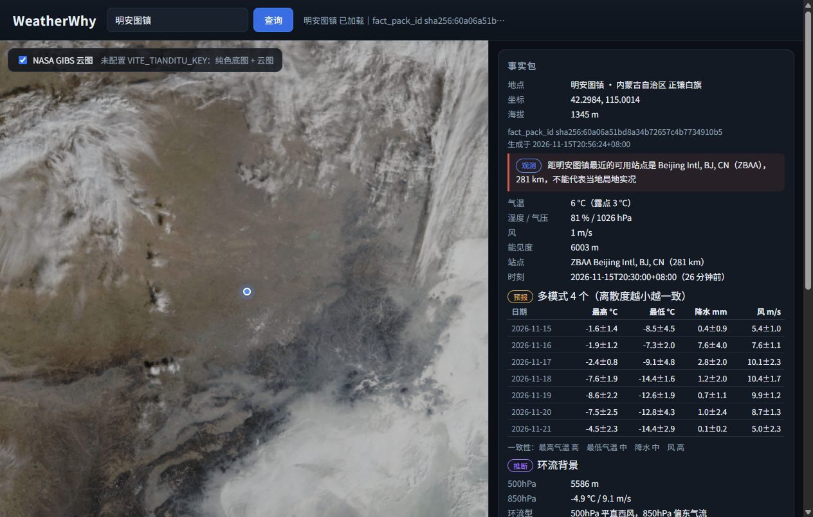
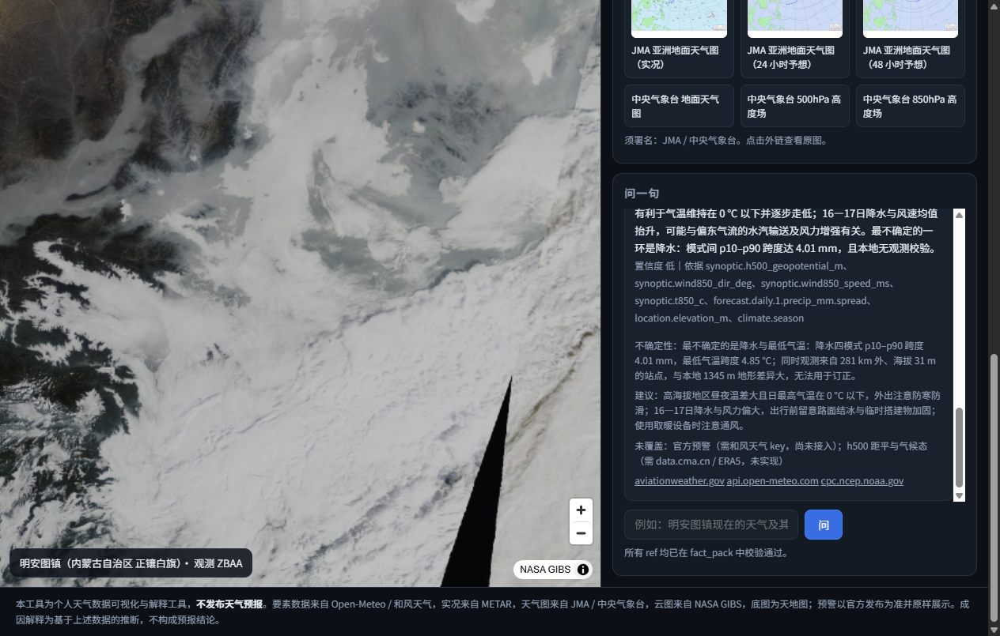

# WeatherWhy（天镜 SkyLens）

> 个人天气数据可视化与解释工具：多源预报 + 云图 + 天气图 + **带出处、分层次、说得出原因**的解释。

给定一个地点，WeatherWhy 把多源天气数据、卫星云图、天气图与环流形势聚合成一份确定性的
**事实包（fact_pack）**，再由 LLM 把这份事实翻译成人话——每个数字都能点回原始来源。

> 命名：对外名称是 **WeatherWhy**；早期设计文档里叫「天镜 SkyLens」，因此仓库内的代码标识
> （Python 包 `skylens`、CLI `skylens`、`SKYLENS_*` 环境变量、`fact_pack` 契约）保持原名不动，
> 只为避免无收益的改名成本。界面与 README 用 WeatherWhy。

| 项 | 值 |
|---|---|
| 名称 | WeatherWhy（旧名 天镜 SkyLens） |
| 形态 | Web 优先 → Capacitor 套壳出 App |
| 技术栈 | Python 3.12+（FastAPI + httpx）、TypeScript（Vite + MapLibre） |
| LLM | DeepSeek / Qwen，OpenAI 兼容接口，key 只在服务端 |
| 用途 | **个人非商用**：不收费、不对外分发数据、不发布自制预报 |

当前进度：**M4 已完成**（CLI + API + 前端单页：地图/云图、多模式预报、500/850hPa 环流、天气图、SSE 对话与引用校验）。路线图见 [里程碑](#里程碑)。

---

## 它做什么

- **事实与解释分离**：`fact_pack` 由确定性 Python 代码组装，不经 LLM；LLM 只负责把已有事实写成人话。
- **每个数字带 provenance**：`{value, unit, source, source_url, valid_time, fetched_at}` 是数据的最小单元。
- **三层信息强制区分**：观测（observed）/ 预报（forecast）/ 推断（inference），UI 配色不同。
- **多模式离散度**：用 Open-Meteo ensemble 的成员级数据算真实 spread，而不是拿几个模式均值假装一致。
- **官方文案只搬运不改写**：预警原文完整并列展示，AI 只做「这是什么意思、我该怎么办」的解读。

## 它不做什么

| 非目标 | 原因 |
|---|---|
| 发布自制天气预报数值 | 《气象预报发布与传播管理办法》统一发布制度 |
| 改写官方预警文案 | 26 号令第九条：不得自行更改内容和结论 |
| 全国全量覆盖 | 个人项目，先做透 1–3 个地点 |
| 实时高并发 | 单用户场景，不做水平扩展 |
| 自研数值预报 | 数据源够用，自研没有收益 |

成功标准（一句话）：对「明安图镇现在的天气及其成因」这个提问，能给出①带时效和来源的实况
②多模式预报一致性 ③基于 500hPa/850hPa 与天气图的成因推断 ④明确标注哪些是观测、哪些是预报、
哪些是推断 ⑤每个数字可点回原始来源。





（截图取自 2026-11-15 实际运行，观测来自 281 km 外的北京首都机场，因此界面明确标注「代表性低」。）

---

## 快速开始

需要 Python ≥ 3.12，推荐用 [uv](https://docs.astral.sh/uv/) 管理环境。

```bash
git clone git@github.com:Eddie-Duan/WeatherWhy.git
cd WeatherWhy
uv sync --all-extras          # 建 .venv 并装齐运行 + dev 依赖

cp .env.example .env          # 填 SKYLENS_LLM_API_KEY（其余 key 可选）
```bash
uv run skylens --help
uv run skylens doctor             # 环境 / 密钥 / LLM / 各数据源一次验完
uv run skylens sources            # 看各数据源授权形态与本机配置状态
uv run skylens where "明安图镇"    # 地理编码候选 + 置信度
uv run skylens pack "明安图镇"     # 组装并打印 fact_pack（--raw 出 JSON）
uv run skylens explain "明安图镇"  # 单次 LLM 解释 + 引用校验（--raw 出 JSON）
uv run python -m skylens          # 打印版本
```

不用 uv 也可以：

```bash
python -m venv .venv && .venv/Scripts/activate   # Windows；POSIX 用 .venv/bin/activate
pip install -e ".[dev]"
python -m skylens
```

### 当前可用命令（M0–M3）

| 命令 | 作用 |
|---|---|
| `skylens doctor` | 检查 Python / 密钥 / LLM 连通 / Open-Meteo / METAR / JMA / ONI（`--no-llm` 跳过计费检查） |
| `skylens version` | 打印版本 |
| `skylens sources` | 列出数据源、授权形态、本地是否已配 key |
| `skylens configure` | 交互式或 `--llm-api-key/--qweather-key/--tianditu-key` 写密钥进 `.env`（0600） |
| `skylens where <地名>` | 地理编码：候选列表 + 行政区 + 置信度 |
| `skylens pack <地名>` | 组装 fact_pack：观测 + 24h 趋势 + 多模式预报 + 环流 + 天气图 + ENSO；`--raw` / `--out` |
| `skylens explain <地名>` | fact_pack → 单次 LLM 解释 → `facts[].ref` 与 `inference.basis[]` 全部校验；不通过就重试一次，仍失败走模板降级 |

`serve` / `ask` 两个旧子命令已被 ``/api`` + 前端取代，不再提供。

### 起 Web 界面（M4）

```bash
# 1) 后端：FastAPI（同时托管已构建的前端）
uv run uvicorn skylens.api.main:app --host 127.0.0.1 --port 8000

# 2a) 生产式：先构建前端，再由后端直接提供页面
cd web && npm install && npm run build && cd ..
# 打开 http://127.0.0.1:8000

# 2b) 开发式：Vite 热更新（/api 已代理到 8000）
cd web && npm run dev      # http://localhost:5173
```

接口（全部返回结构化 JSON；`/api/explain` 另有 SSE）：

| 方法 | 路径 | 说明 |
|---|---|---|
| GET | `/api/healthz` | 存活与版本 |
| GET | `/api/fact_pack?place=&days=` | 确定性事实包，进程内缓存 15 min |
| GET | `/api/explain?place=` | 非流式解释（便于 curl / 测试） |
| POST | `/api/explain` | SSE：`stage` → `stage` → `stage` → `answer` → `done` |
| GET | `/api/charts` | 天气图链接（JMA 实况/24h/48h + 中央气象台外挂页） |
| GET | `/api/warnings?lat=&lon=` | 官方预警；**未接入时明确返回 `available: false`**，不编造 |

前端没有用框架：`maplibre-gl` + 原生 TS，构建产物约 290 kB（gzip）。三层信息用
`观测=蓝 / 预报=琥珀 / 推断=紫` 区分，引用以 `facts[].ref` 显示在数值旁边。

### 需要你去申请的 key

| key | 用途 | 是否必需 | 申请入口 |
|---|---|---|---|
| **天地图** | 底图（**审图号合规**，没有则降级为纯色底图 + 云图） | 推荐 | <https://console.tianditu.gov.cn>（实名，免费） |
| **和风天气** | 中国区要素、公里级格点、**官方预警** | 可选 | <https://console.qweather.com>（免费开发版） |
| DeepSeek | 解释层（缺失则永远走模板降级） | 已配置 | <https://platform.deepseek.com> |
| data.cma.cn | 气候态 / 500hPa 距平 | 可选 | <https://data.cma.cn>（注册，非商用条款） |
| Open-Meteo / METAR / JMA / 中央气象台 / NASA GIBS / NOAA / Nominatim | 其余全部数据 | **免密钥** | — |

天地图 key 填 `web/.env` 的 `VITE_TIANDITU_KEY`；和风天气 key 填根目录 `.env` 的
`SKYLENS_QWEATHER_KEY`（CLI 的 `sources` 与 `doctor` 会告诉你缺哪个）。

典型输出（2026-11-15 实测，观测来自 281 km 外的北京首都机场）：

```text
──────────────── 明安图镇 · 内蒙古自治区 正镶白旗 ────────────────
42.2984, 115.0014｜海拔 1345 m｜地理编码 nominatim（0.85）
观测 2026-11-15T19:00:00+08:00（6 分钟前）
  10 °C  露点 3 °C  湿度 62%  气压 1025 hPa
  站点 ZBAA Beijing Intl, BJ, CN｜代表性 低：281 km，不能代表当地局地实况
环流 500hPa 5591 m｜850hPa -4.6 °C 79° 8.8 m/s｜型：500hPa 平直西风，850hPa 偏东气流
气候 初冬｜ENSO El Niño（ONI 2.46，2026-09）
缺失：官方预警（需和风天气 key，M4 接入）；h500 距平与气候态（需 data.cma.cn / ERA5）
```

---

## 里程碑

| 阶段 | 内容 | 验收标准 |
|---|---|---|
| **M0** ✅ | 建仓、目录、settings、CI（ruff + pytest） | `uv run pytest` 绿；`python -m skylens` 打印版本 |
| **M1** ✅ | provider 层 + Open-Meteo + METAR + 中文地理编码 | `skylens pack "明安图镇"` 打印完整 fact_pack JSON |
| **M2** ✅ | 统计 + synoptic + 天气图 URL + ENSO | `forecast.agreement` 与 `synoptic.pattern` 非空 |
| **M3** ✅ | explain 层 + 模板降级 + 引用校验 | `facts[].ref` 全部可在 fact_pack 中解析 |
| **M4** ✅ | FastAPI + 前端单页（地图 + 聊天 + 天气图） | 浏览器能看云图、能提问、引用可点 |
| **M5** | Capacitor 打包 | Android 真机能装、能显示地图、能对话 |
| **M6** | 回归问题集（10 个明安图/锡林浩特/二连浩特问题） | `not_covered` 与 `basis` 合理，无编造数值 |

---

## 目录结构

```text
.
├── docs/
│   ├── TECHNICAL_DESIGN.md   # 技术说明：架构、fact_pack 契约、解释层、合规
│   ├── MIGRATION.md          # 从 weather-ensemble-agent 迁移的逐文件处置与步骤
│   └── DATA_SOURCES.md       # 各数据源的授权与署名要求（合规留痕）
├── src/skylens/
│   ├── __init__.py           # 版本号
│   ├── __main__.py           # python -m skylens
│   ├── settings.py           # pydantic-settings 配置层
│   ├── net.py                # HTTP client 工厂（共享 SSL 上下文）
│   ├── doctor.py             # 环境/密钥/LLM/数据源体检
│   ├── cli.py                # cyclopts + rich 命令行
│   ├── prompts/explain_v1.txt # 解释层 system prompt（可版本化）
│   ├── core/                 # 确定性核心：除 explain.py 外不调 LLM
│   │   ├── fact_pack.py      # 编排 providers → fact_pack
│   │   ├── synoptic.py       # 500/850hPa 环流型规则判定
│   │   ├── stats.py          # ← 从旧仓 statistics.py 迁移
│   │   ├── units.py          # 单位换算唯一入口
│   │   ├── vocab.py          # 中文术语、分级阈值、季节
│   │   ├── validate.py       # assert_refs_resolvable（防幻觉核心）
│   │   ├── explain.py        # 单次 LLM 调用 + 重试
│   │   └── template.py       # LLM 不可用时的降级
│   ├── providers/
│   │   ├── base.py           # Sourced + Provider Protocol（数据契约）
│   │   ├── registry.py       # endpoint 与模式清单（旧仓硬编码的收容处）
│   │   ├── geocode.py        # QWeather → Nominatim → Open-Meteo
│   │   ├── open_meteo.py     # 多模式逐日预报 + 500/850hPa 环流
│   │   ├── metar.py          # 最近机场实况 + 24h 趋势 + 代表性
│   │   ├── charts.py         # JMA 地面图 + 中央气象台外链
│   │   └── enso.py           # NOAA CPC ONI
│   ├── cache/store.py        # TTL 文件缓存
│   └── api/                  # FastAPI：routes.py（接口+SSE）/ main.py（装配+CORS）
├── web/                      # Vite + TS + MapLibre（无框架）
│   ├── index.html
│   ├── src/{main,api,map,panels,chat}.ts
│   └── src/theme.css
└── tests/                    # pytest：统计/单位/配置/各 provider/fact_pack/校验/解释/API/CLI
```

`serve`、`ask`、`qweather.py`、预警搬运、Capacitor 套壳在 M5–M6 补上。
完整设计与取舍见 [docs/TECHNICAL_DESIGN.md](docs/TECHNICAL_DESIGN.md)。

### 实测与文档的偏差（有据可查）

| 项 | 文档说法 | 实测（2026-11-15） | 处理 |
|---|---|---|---|
| 中文地名源顺序 | QWeather 主、Open-Meteo 备、Nominatim 兜底 | Open-Meteo geocoding 对「明安图镇 / 正镶白旗」**返回空**；Nominatim 精确命中（42.2984, 115.0014，正镶白旗） | 顺序改为 QWeather → **Nominatim** → Open-Meteo，理由写进模块文档 |
| 离散度来源 | ensemble 成员级 spread | M2 仍是 4 个模式逐日 p10–p90（模式间离散度） | `forecast.agreement` 已可用；成员级 ensemble 待接入，契约不变 |
| METAR 最近站 | 站点表或 stationinfo | `bbox` 查询最省事；锡林浩特 ZBXH 当时无报，最近可用站是 281 km 外的 ZBAA | bbox 逐级放大（4°→8°），代表性落成「低」并写进 fact_pack |
| 解释层 `max_tokens` | 2000 | 2000 时真实回答被截断（`finish_reason=length`，JSON 断在 4134 字符） | 默认提到 3000 + 截断检测 + 重试时要求「精简、facts ≤ 6 条」 |
| 引用路径写法 | 文档写 `daily[0].temp_max` | DeepSeek 实际写 `daily.1.precip_mm.mean`（点号下标），浏览器端因此降级过一次 | 解析器同时接受 `[1]` 与 `.1` 两种下标写法，仍然只认 fact_pack 里真实存在的路径 |
| 模型名 | `deepseek-chat` | 服务端返回的实际模型是 `deepseek-flash` | 配置不变（用官方别名），`doctor` 会打印真实模型名 |

---

## 数据源与署名

要素与预报来自 **Open-Meteo**（含 ensemble）与 **和风天气**；实况来自 **METAR**
（aviationweather.gov）；天气图来自 **JMA** 与 **中央气象台**；云图瓦片来自 **NASA GIBS**；
底图为 **天地图**（已通过国家地图审核，App 内标识审图号）；ENSO 指数来自 **NOAA CPC**。

各源的授权、署名要求与限制见 [docs/DATA_SOURCES.md](docs/DATA_SOURCES.md)。

---

## 免责声明与合规

> 本工具为个人天气数据可视化与解释工具，**不发布天气预报**。
> 要素数据来自 Open-Meteo / 和风天气，实况来自 METAR，天气图来自 JMA / 中央气象台，
> 预警信息以官方发布为准并原样展示。成因解释为基于上述数据的推断，不构成预报结论。

与是否商用无关的三条硬约束（实现层面强制）：

1. **预警与官方预报原样传播**：注明台站名称与发布时间，不得更改内容和结论；AI 解读与原文分栏显示。
2. **不得向境外提供从 data.cma.cn 获取的资料**：LLM 只用境内模型；将来接境外模型时须按 `origin` 标记剥离。
3. **地图须有审图号**：底图用天地图；全项目 WGS-84/CGCS2000，禁止 GCJ-02 纠偏与混搭。

---

## 开发

```bash
uv run ruff check .          # lint
uv run ruff format .         # 格式化
uv run pytest                # 全量测试
pre-commit install           # 可选：提交前自动跑 ruff + pytest
```

CI（GitHub Actions）在每次 push 到 `main` 和每个 PR 上跑 ruff check、ruff format --check、pytest。

---

## 许可

代码以 [MIT](LICENSE) 发布。项目本身非商用；第三方数据的授权以其各自条款为准。
